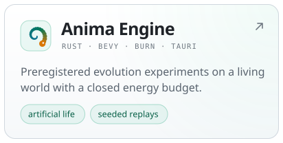
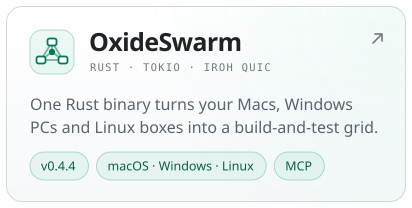
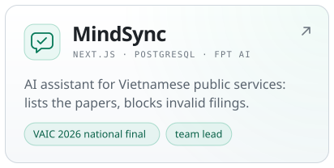
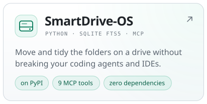
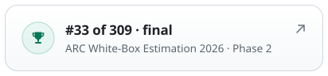
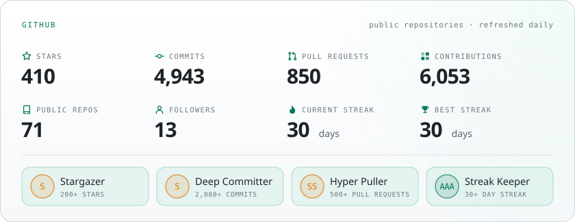
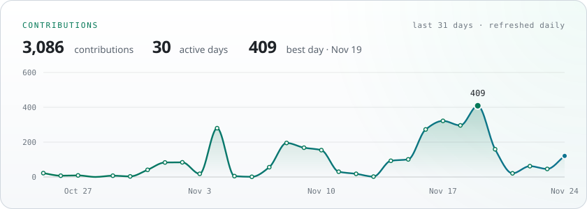

<!-- Generated art, one light and one dark file per image: scripts/generate_banner.py renders the header, the project cards and the achievement tiles; scripts/generate_activity.py renders the activity graph from assets/activity.json and scripts/generate_stats.py the stats panel from assets/stats.json, both refreshed by the daily workflow. -->

<picture>
  <source media="(prefers-color-scheme: dark)" srcset="./assets/header-dark.svg">
  
</picture>

  <a href="https://linkedin.com/in/d%C6%B0%C6%A1ng-nguy%E1%BB%85n-anh-021b6a39b">LinkedIn</a> &nbsp;·&nbsp;
  <a href="mailto:duonganhdn2000@gmail.com">Email</a> &nbsp;·&nbsp;
  <a href="https://huggingface.co/Duong2006">Hugging Face</a>

Software Engineering student at **FPT University**, Hanoi. I build **AI agents that remember, reason and act**, and **simulations where behaviour evolves from simple rules** — mostly in Rust, Python and TypeScript.

### Selected work

  <a href="https://github.com/DuongNAD/Anima-Engine"><picture><source media="(prefers-color-scheme: dark)" srcset="./assets/card-anima-dark.svg"></picture></a>
  <a href="https://github.com/DuongNAD/OxideSwarm"><picture><source media="(prefers-color-scheme: dark)" srcset="./assets/card-oxideswarm-dark.svg"></picture></a>
  <a href="https://github.com/DuongNAD/VN_AI_Innovation"><picture><source media="(prefers-color-scheme: dark)" srcset="./assets/card-mindsync-dark.svg"></picture></a>
  <a href="https://github.com/DuongNAD/smart-drive-os"><picture><source media="(prefers-color-scheme: dark)" srcset="./assets/card-smartdrive-dark.svg"></picture></a>

### Recognition

  <a href="https://www.hackerrank.com/contests/hackerrank-orchestrate-october26/challenges/ghost-data-still-exists/leaderboard?page=2"><picture><source media="(prefers-color-scheme: dark)" srcset="./assets/award-hackerrank-dark.svg"></picture></a>
  <a href="https://www.aicrowd.com/challenges/arc-white-box-estimation-challenge-2026/leaderboards?round=phase-2"><picture><source media="(prefers-color-scheme: dark)" srcset="./assets/award-arc-dark.svg"></picture></a>
  <a href="https://drive.google.com/file/d/1K1Sfw4AnxBfi7deHBIaIqpH9cJ-G3ti9/view"><picture><source media="(prefers-color-scheme: dark)" srcset="./assets/award-denso-dark.svg"></picture></a>
  <a href="https://github.com/DuongNAD/VN_AI_Innovation"><picture><source media="(prefers-color-scheme: dark)" srcset="./assets/award-vaic-dark.svg"></picture></a>

Also: <a href="https://drive.google.com/file/d/1Hl0qvEHIbgp6Fus2o0EukKZImMNrEr-I/view">HackerRank Orchestrate certificate, September 2026</a>

### Toolbox

<picture>
  <source media="(prefers-color-scheme: dark)" srcset="https://skillicons.dev/icons?i=python%2Crust%2Cts%2Creact%2Cnextjs%2Cvue%2Ctauri%2Cnodejs%2Cfastapi%2Cpytorch%2Cpostgres%2Csqlite%2Cdocker%2Cgithubactions%2Clinux&perline=15&theme=dark">
  
</picture>

### Activity

<picture>
  <source media="(prefers-color-scheme: dark)" srcset="./assets/stats-dark.svg">
  
</picture>

<picture>
  <source media="(prefers-color-scheme: dark)" srcset="./assets/activity-dark.svg">
  
</picture>
