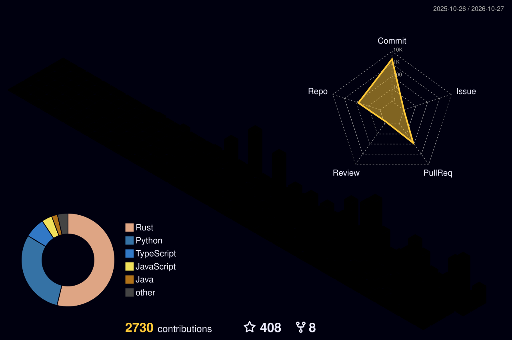

<!-- Banner, project cards and footer are generated by scripts/generate_banner.py; the highlights panel and the activity graph by scripts/generate_highlights.py and scripts/generate_activity.py (numbers from the daily widget refresh) -->

  

  <a href="https://linkedin.com/in/d%C6%B0%C6%A1ng-nguy%E1%BB%85n-anh-021b6a39b">LinkedIn</a> &nbsp;·&nbsp;
  <a href="mailto:duonganhdn2000@gmail.com">Email</a> &nbsp;·&nbsp;
  <a href="https://huggingface.co/Duong2006">Hugging Face</a>

Software Engineering student at **FPT University**, Hanoi. I build **AI agents that remember, reason and act**, and **simulations where behaviour evolves from simple rules** — mostly in Rust, Python and TypeScript.

### Highlights

  

  Certificates: <a href="https://drive.google.com/file/d/1Hl0qvEHIbgp6Fus2o0EukKZImMNrEr-I/view">HackerRank Orchestrate</a> &nbsp;·&nbsp;
  <a href="https://drive.google.com/file/d/1K1Sfw4AnxBfi7deHBIaIqpH9cJ-G3ti9/view">DENSO Factory Hacks</a> &nbsp;·&nbsp;
  Leaderboard: <a href="https://www.aicrowd.com/challenges/arc-white-box-estimation-challenge-2026/leaderboards?round=phase-2">ARC White-Box Estimation</a>

### Selected work

  
  
  
  

### Toolbox

  

### Activity

<picture>
  <source media="(prefers-color-scheme: dark)" srcset="./assets/github-contribution-grid-snake-dark.svg">
  <source media="(prefers-color-scheme: light)" srcset="./assets/github-contribution-grid-snake.svg">
  
</picture>

More GitHub stats

 

  
  
  

  

